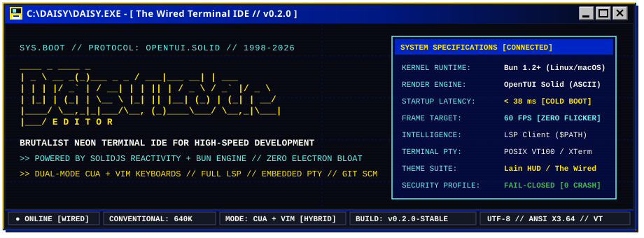

<p align="center">
  <b>[ English ]</b> · <a href="README.pt-BR.md"><b>[ 🇧🇷 Versão em Português ]</b></a> · <a href="ROADMAP.md"><b>[ Roadmap ]</b></a>
</p>

<p align="center">
  
</p>

<p align="center">
  
  
  
  
  
  
</p>

<p align="center">
  <a href="https://bun.sh"></a>
  <a href="https://www.typescriptlang.org"></a>
  <a href="https://www.solidjs.com"></a>
  <a href="https://github.com/opentui"></a>
  <a href="https://github.com/raillen/daisy-code-editor/releases"></a>
  <a href="LICENSE"></a>
</p>

```text
╔══════════════════════════════════════════════════════════════════════════════╗
║  DAISY CODE EDITOR // SYSTEM BUILD 0.2.0 // PROTOCOL: THE WIRED              ║
║  "No matter where you go, everyone's always connected."                      ║
╚══════════════════════════════════════════════════════════════════════════════╝
```

> **Daisy Code Editor** is an ultra-fast, modular terminal code editor and mini-IDE built with **OpenTUI + SolidJS** on top of **TypeScript & Bun**.
>
> Engineered for sub-40ms cold boots, zero browser bloat, seamless hybrid CUA/Vim editing, and an authentic 90s brutalist cyber-dystopian terminal HUD inspired by *Serial Experiments Lain* and classic computing systems.

---

## [ 🖵 ] System Capabilities

### [ 🗲 ] [SYS.ENGINE] Reactive ASCII Terminal Engine
- Fine-grained reactivity powered by `@opentui/core` and `@opentui/solid`.
- Recalculates only modified cells in an optimized memory buffer; zero whole-screen repaints.
- Predictable 60 FPS performance with mouse drag, wheel scrolling, and dynamic terminal window resizing.

### [ 🗀 ] [DRIVE.TREE] File Explorer & Tabbed Buffers
- Navigable hierarchical directory tree with optional Nerd Font glyphs (`icons = true`).
- Multi-tab document management with middle-click tab closing and dirty state indicators (`●`).
- Resizable split viewports (horizontal and vertical) with draggable dividers.

### [ 🖳 ] [PTY.SHELL] Embedded POSIX Terminal Emulator
- Built-in full interactive terminal multiplexer (`Ctrl+\``) executing user shell (`bash`, `zsh`, `fish`).
- Native VT100/ANSI escape sequence processing with direct keyboard pass-through.
- Draggable split divider to adjust terminal height or editor viewport ratio on the fly.

### [ ⚙ ] [LSP.INTEL] Language Server Protocol ($PATH Client)
- Decoupled LSP architecture running external language servers via `$PATH` (`rust-analyzer`, `typescript-language-server`, `gopls`, `pyright`, `clangd`).
- **Autocompletion**: Contextual LSP suggestions merged with local buffer word indexing and fuzzy ranking.
- **Hover Documentation (`K` / `Ctrl+K`)**: Live signatures, types, and Markdown docstrings in a floating reader overlay.
- **Go to Definition (`F12` / `gd`)**: Instant symbol jump across workspace files.
- **Rename Symbol (`F2`)**: Project-wide AST refactoring across multiple buffers with atomic edits.
- **Format on Save**: Automatic code formatting via language servers or external CLI tools.
- **Fail-Closed Resilience**: If an LSP server exits, editor buffers remain 100% stable without crashes.

### [ ░▒▓ ] [HUD.THEMES] Cyberpunk Daisy-Lain Aesthetic & 15 Themes
- First-class brutalist cyberpunk aesthetic suite inspired by [daisyweblain](https://daisyweblain.vercel.app/):
  - **`daisy-lain`** [The Wired]: Midnight Void `#070913`, Acid Yellow `#ffe500`, Cobalt `#0025c5`, Signal Cyan `#67f4ed`.
  - **`daisy-lain-cobalt`** [Hero Blue]: Dense Cobalt `#020d58`, Acid Yellow wireframes, Signal White `#f8f7eb`.
  - **`daisy-lain-glitch`** [CRT Anomaly]: Laser Glitch Crimson `#ff4068`, Signal Cyan, Midnight Void.
  - **`daisy-lain-bone`** [Brutalist Bone Paper]: High-contrast raw bone `#f2efe6`, pitch black ink, yellow highlights.
- 11 classic themes included: Catppuccin Mocha, Nord, Tokyo Night, Dracula, Gruvbox, One Dark, etc.
- Interactive live-preview switcher in the Command Palette: preview themes instantly while scrolling!

### [ ⌕ ] [FAST.FIND] High-Velocity Search & Replace
- Buffer-level search & replace with regular expressions, case-matching, whole-word filtering, and accent-folding.
- Project-wide grep with glob patterns (`Ctrl+Shift+F`), listing matching files and lines with instant navigation.
- Dedicated background Web Worker for fuzzy finding across 20,000+ files without UI stutter.

### [ 🖧 ] [GIT.SCM] Version Control & Real-time Gutter
- Real-time Git Gutter status indicators in the line number margin (`+` added, `~` modified, `-` deleted).
- Dedicated SCM modal (`Ctrl+Shift+G`) displaying branch name, commits ahead/behind, and staged/unstaged files (`s` stage, `u` unstage, `d` diff, `c` commit).
- **Inline Git Blame (`Alt+B`)**: Displays author, commit hash, date, and message for the current line.
- **Diff Viewer (`show_diff`)**: Formatted git diff overlay for modified working tree files.
- `git pull` and `git push` synchronization with safe confirmation dialogs.

### [ 🤖 ] [AI.AGENTS] Agent Panel (Right Slot)
- Right-hand panel for AI pair-programmer conversations (`Ctrl+Shift+A`): inline prompt input (`Enter` sends, `Esc` returns focus), per-conversation tabs (`Ctrl+N` new, `Ctrl+W` close, `Ctrl+Tab` cycle) and a resizable divider persisted per workspace.
- Provider-agnostic by contract: adapters implement `AgentProvider` (`src/services/agents.ts`) — the native OpenCode provider and ACP agents land on this slot next.
- Ships an `echo` demo provider so the panel works offline (tests and demos), and fails closed with a status message when no provider is available.

### [ 🗎 ] [DOC.VIEW] Live Markdown Preview
- Real-time split preview for Markdown and MDX documents (`Alt+P`).
- Renders formatted headings, styled tables, bullet lists, blockquotes, and Shiki-highlighted code blocks.
- Synchronized keyboard and mouse wheel scrolling without modifying underlying document text.

### [ 🖮 ] [VIM.MODAL] Dual-Mode Editing (CUA + Vim)
- Standard modern shortcuts (`Ctrl+C`, `Ctrl+V`, `Ctrl+Z`, `Ctrl+S`, `Ctrl+F`, `Ctrl+P`).
- Optional Vim modal mode (`toggle_modal`):
  - Modes: Normal, Insert, Visual, Visual-Line.
  - Motions: `h, j, k, l, w, b, e, 0, $, gg, G`.
  - Operators: `dd, yy, x, p, P, u, Ctrl+R`.
  - Commands: `:w, :wq, :q, :q!, :tasks, :health, /search, n, N`.
- Multicursor workflows: add cursors above/below (`Ctrl+Alt+Up/Down`), select all occurrences, surround selection.

### [ 🗖 ] [MENU.CUA] Windows 98 / CUA Mnemonic Menus & Command Palette
- **Alt Mnemonic System**: Pressing `Alt` or `F10` underlines active hotkeys (`<u><b>F</b></u>ile`, `<u><b>E</b></u>dit`, etc.).
- Dual-hotkey routing supporting both Portuguese (`Alt+A, Alt+E, Alt+X...`) and English (`Alt+F, Alt+E, Alt+V...`).
- Global Command Palette (`Ctrl+Shift+P`): Fuzzy search across all menu items, theme selectors, locale options, and plugin commands.

### [ 🔌 ] [PLUG.HOOKS] Modular Plugins & Task Runner
- Declarative plugins loaded from `~/.config/daisy/plugins/` or `.daisy/plugins/` via `plugin.toml`.
- Lifecycle execution hooks: `on_open`, `on_save`.
- Dynamic path interpolations: `$FILE`, `$DIR`, `$WORKSPACE`.
- Project task runner via `tasks.toml` (`run_tasks`).

---

## [ C:\> ] Quickstart & Installation

```text
┌────────────────────────────────────────────────────────┐
│ C:\> INSTALL.BAT --UNIVERSAL                           │
└────────────────────────────────────────────────────────┘
```

### [ 🗲 ] One-Line Universal Webcore Installer (Linux & macOS)

Install Daisy directly through our interactive multi-architecture script:

```bash
curl -fsSL https://raw.githubusercontent.com/raillen/daisy-code-editor/main/scripts/install.sh | bash
```

Automated / Non-interactive installations:

```bash
# Explicit package format: appimage | arch | deb | rpm | flatpak | binary
FORMAT=appimage curl -fsSL https://raw.githubusercontent.com/raillen/daisy-code-editor/main/scripts/install.sh | bash

# Specific pinned version
VERSION=v0.2.0 curl -fsSL https://raw.githubusercontent.com/raillen/daisy-code-editor/main/scripts/install.sh | bash
```

---

### [ 🖴 ] Precompiled Distribution Packages

Direct binary downloads are hosted on [GitHub Releases](https://github.com/raillen/daisy-code-editor/releases):

| Platform / Format | Installation Command |
|---|---|
| **Universal AppImage** | `chmod +x Daisy-x86_64.AppImage && ./Daisy-x86_64.AppImage` |
| **Arch Linux (PKGBUILD)** | `sudo pacman -U daisy-code-editor-0.2.0-1-x86_64.pkg.tar.zst` |
| **Debian / Ubuntu (.deb)** | `sudo dpkg -i daisy_0.2.0_amd64.deb` |
| **Fedora / RHEL (.rpm)** | `sudo dnf install ./daisy-code-editor-0.2.0-1.x86_64.rpm` |
| **Flatpak Bundle** | `flatpak install --bundle daisy-0.2.0.flatpak` |
| **Standalone Binary** | `chmod +x daisy-linux-x64 && sudo mv daisy-linux-x64 /usr/local/bin/daisy-code` |

---

### [ ⚙ ] Build from Source (Bun 1.2+)

```bash
# 1. Clone repository
git clone https://github.com/raillen/daisy-code-editor.git
cd daisy-code-editor

# 2. Install dependencies
bun install

# 3. Run automated tests (97 tests)
bun test

# 4. Launch editor
bun run dev

# 5. Build standalone binary
bun run build
```

---

## [ 🖮 ] Keyboard Navigation & Mnemonics

```text
┌────────────────────────────────────────────────────────────────────────────┐
│ HOTKEY              ACTION DESCRIPTION                                     │
├────────────────────────────────────────────────────────────────────────────┤
│ F10 / Alt           Toggle menu bar hotkey mnemonics (Underlined keys)     │
│ Alt+F / Alt+A       File Menu [A]rquivo / [F]ile                           │
│ Alt+E               Edit Menu [E]ditar / [E]dit                            │
│ Alt+V / Alt+X       View Menu E[x]ibir / [V]iew                            │
│ Alt+S / Alt+C       Settings Menu [C]onfigurações / [S]ettings             │
│ Alt+G / Alt+I       Navigation Menu [I]r / [G]o                            │
│ Alt+T               Git Menu Gi[t]                                         │
│ Alt+H / Alt+J       Help Menu A[j]uda / [H]elp                             │
│ Ctrl+Shift+P        Global Command Palette (Fuzzy command search)          │
│ Ctrl+P              Quick File Finder                                      │
│ Ctrl+`              Toggle Embedded POSIX Terminal (PTY)                   │
│ Ctrl+Shift+G        Toggle Git / SCM Overlay                               │
│ Ctrl+Shift+A        Toggle AI Agents Panel (Ctrl+N new · Enter send)       │
│ Alt+P               Toggle Live Markdown Preview Split                     │
│ Ctrl+F              Find in Current Buffer                                 │
│ Ctrl+H              Find and Replace in Buffer                             │
│ Ctrl+Shift+F        Project-wide Search / Grep                             │
│ F2                  Rename Symbol (LSP / AST)                              │
│ F12                 Go to Definition (LSP)                                 │
│ K / Ctrl+K          Show Hover Documentation (LSP)                         │
│ Alt+B               Git Blame for Current Line                             │
│ Ctrl+\              Split Editor Pane (Vertical)                           │
│ Ctrl+Shift+\        Split Editor Pane (Horizontal)                         │
│ Alt+/               Which-Key Cheatsheet Overlay                           │
└────────────────────────────────────────────────────────────────────────────┘
```

---

## [ 💾 ] Configuration (`config.toml`)

Daisy stores user preferences in `~/.config/daisy/config.toml` (compatible with `.daisy/` or `.oride/`). Edit directly inside Daisy via **Settings -> User settings (TOML)** (`open_user_config`):

```toml
# Daisy Code Editor Configuration
theme = "daisy-lain"          # Options: daisy-lain, daisy-lain-cobalt, daisy-lain-glitch, daisy-lain-bone, catppuccin-mocha, nord...
locale = "en-US"              # "en-US" or "pt-BR"
soft_wrap = false
auto_pairs = true
show_line_numbers = true
icons = true                  # Enable Nerd Font single-cell file glyphs
mouse = true                  # Enable mouse capture and scrolling

[editor]
tab_size = 2
insert_spaces = true
format_on_save = true

[tree]
width = 28
show_hidden = false

[keys]
"ctrl+s" = "save"
"ctrl+shift+p" = "command_palette"
"alt+p" = "toggle_md_preview"
```

---

## [ 🏛️ ] Architecture & Codebase Layout

Daisy follows Clean Architecture principles with a strictly decoupled core:

```text
src/
  ├── core/        [PURE DOMAIN] document, keymap, search (0 external dependencies)
  ├── services/    [ADAPTERS] files, git, lsp, terminal, catalogs, plugins
  ├── app/         [ORCHESTRATION] state container, command dispatchers, Vim engine
  ├── ui/          [PRESENTATION] OpenTUI Solid components (workbench, editor, theme)
  └── workers/     [BACKGROUND WORKER] high-throughput fuzzy file indexer
```

### Core Invariants:
1. **Pure Core, Imperative Shell**: `src/core` is 100% testable in memory without any TTY or DOM emulation.
2. **Actions as Data**: Every keybinding, palette item, and menu entry dispatches a typed `ActionId`.
3. **Fail-Closed Design**: External process failures (LSP, Git CLI, PTY) report status gracefully and never crash the editor.
4. **Zero Compiler Coupling**: Language intelligence runs exclusively via external binaries in `$PATH`.

---

## [ ⚙.LOG ] Automated Verification

```bash
# Run full automated test suite (97 tests)
bun test

# Run strict TypeScript typechecker
bun run typecheck

# Build bundle
bun run build
```

---

## [ SYS.MAP ] Roadmap & Vision

Explore the future vision, active progress, and upcoming milestones from **v0.3.0** (Tree-Sitter, Code Folding) through **v1.0 (LTS)** in our **[ROADMAP.md](ROADMAP.md)**.

---

## [ 📄 ] License & Credits

Daisy Code Editor is open-source software licensed under the **[MIT License](LICENSE)**.

Designed & built by **raillen** and contributors. Inspired by *Serial Experiments Lain*, *The Wired*, and brutalist terminal aesthetics.
