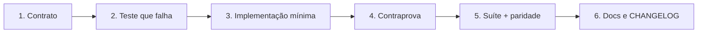

# Estratégia de Testes e Ciclo de Qualidade

Nenhum código é integrado sem evidência automatizada. Este documento diz **quais
checks bloqueiam** e o que cada um prova — porque um gate que mede frames, testes
e paridade sem perguntar se uma tecla faz alguma coisa já deixou passar uma TUI
inutilizável aqui (ver §5).

A implementação alvo é **Go** (`cmd/`, `internal/`); o **Rust** (`crates/`) é o
oráculo diferencial e é buildado pelo CI ao lado dela.

---

## 1. O loop



1. **Contrato** — o comportamento observável, não a assinatura interna.
2. **Teste que falha primeiro** — inclusive para correção de defeito: o caso
   `conformance/cases/<feature>/*.json` reproduz a divergência.
3. **Implementação mínima** que satisfaz o teste.
4. **Contraprova** — a prova de que o teste é capaz de falhar. Um teste que nunca
   falhou não mediu nada: `TestRulesCanFail`, `TestComparatorDetectsDivergence` e
   `TestDocumentedKeymapFailsOnATypo` existem por isso.
5. **Suíte e paridade** (§3).
6. **Documentação e `CHANGELOG.md`** no mesmo commit do código.

---

## 2. As camadas

### A. Domínio puro
Testes unitários determinísticos, sem TTY, sem rede: `internal/buffer`,
`internal/editor`, `internal/action`, `internal/keymap`, `internal/config`,
`internal/search`, `internal/syntax`. Onde o dump do oráculo expõe o estado, o
teste compara **byte a byte** contra o Rust.

### B. Adaptadores
I/O real com fixture isolada: `internal/fs`, `internal/git`, `internal/lsp`
(transporte separado do processo, o cliente inteiro testado por um pipe),
`internal/term` (PTY), `internal/session` (digest FNV-1a contra valores golden do
Rust), `internal/plugin` (execução sem shell).

### C. Superfícies
Renderização sem terminal, asserção sobre a **string renderizada** e não sobre o
valor parseado: `internal/tui/*`. Cor não resolvida é no-op silencioso, e um teste
que compara o valor parseado passa com o produto monocromático.

### D. Conformidade e validação estática
- **Formato**: `gofmt -l cmd internal conformance` sem saída; `cargo fmt --all -- --check`.
- **Vet e lint**: `go vet ./...`; `staticcheck ./...`; `cargo clippy --all-targets -- -D warnings`.
- **Tabelas geradas**: `python3 scripts/gen-tables.py --check` compara ids de ação,
  bindings e as 252 cores do registro de temas com o oráculo.
- **Sem CGO**: `CGO_ENABLED=0 go build ./...` a cada mudança, não no release.

### E. Contratos de arquitetura e de documentação
- `internal/architecture`: R1–R7 como teste, cada regra com contraprova.
- `internal/docdrift`: `docs/ui-ux/keymap.md` é **gerado** das 98 bindings e
  comparado nos dois sentidos.

### F. Paridade diferencial
`go test ./conformance/...` executa o mesmo caso contra as duas implementações e
compara sem tolerância. Duas garantias sustentam o número: o oráculo é
determinístico e o comparador **detecta** divergência. Toda divergência
intencional está em `docs/migration/parity-ledger.md` com veredito — *spec vence*,
*código vence*, *removido* ou *melhoria*.

### G. Limites declarados
- **Cobertura de 85%**: alvo histórico, **sem gate**. Não existe medição no CI
  que o sustente, e um número que nada mede é uma afirmação sem evidência — fica
  escrito aqui como dívida, não como promessa.
- **Golden frames**: só para o que é **função pura do estado**. O campo de filtro
  do componente `list` pisca; a saída depende do relógio, e um golden passaria
  numa máquina rápida e falharia numa lenta. As sobreposições ficaram fora da
  matriz com o motivo registrado no código.
- **Benchmarks e fuzz**: não existem ainda. Estão no M5 como trabalho real.

---

## 3. Os checks que bloqueiam

| Check | Comando | O que falha quando |
|---|---|---|
| Formatação | `gofmt -l cmd internal conformance` | um arquivo fora do padrão |
| Vet | `go vet ./...` | diagnóstico do compilador ou do vet |
| Lint | `staticcheck ./...` | código que compila mas está errado |
| Testes | `go test -race ./...` | qualquer regressão, e `-race` pega concorrência |
| Sem CGO | `CGO_ENABLED=0 go build ./...` | alguém introduz CGO no alvo distribuído |
| Tabelas | `python3 scripts/gen-tables.py --check` | tabela diverge do oráculo |
| Paridade | `go test ./conformance/...` | o Go faz algo que o oráculo não faz |
| Governança | `prumo validate` · `prumo docs verify` | manifesto ou documentação divergem do código |

O gate do marco acrescenta o **teste de fumaça** (S5), que dirige a TUI como um
usuário: abre, anda na árvore, digita, busca, fecha. Sem ele, um gate que mede
frames e contagens passa com um programa que não fecha.

---

## 4. Ordem de execução

```bash
gofmt -l cmd internal conformance   # format
go vet ./...                        # vet
go test -race ./...                 # suíte
python3 scripts/gen-tables.py --check
CGO_ENABLED=0 go build ./...        # alvo distribuído
go test ./conformance/...           # paridade, exige o oráculo buildado
prumo validate && prumo docs verify # governança
```

O job de paridade do CI faz `cargo build -p oride` antes: `cargo test` não
renova o binário em `target/debug`, e um oráculo velho faria o gate comparar o Go
contra a revisão anterior do Rust sem dizer nada.

---

## 5. O que um gate não mede

Nove checks verdes conviveram com uma TUI em que não se fechava o programa, não
se navegava a árvore e os menus não faziam nada. Frame, teste e paridade não
perguntam se uma tecla funciona — e "marco completo" era verdade sobre a medição e
mentira sobre o produto. Duas consequências já são regra:

1. **Teste de fumaça por marco** (S5): caminhos, não frames.
2. **Regra de aptidão** (S4): configuração sem consumidor falha o build.

E uma que nenhuma máquina verifica: **um desvio do plano declarado quando
acontece**. O componente `list` foi omitido em silêncio porque nada falhou, e uma
linha no relatório de marco teria custado nada.
